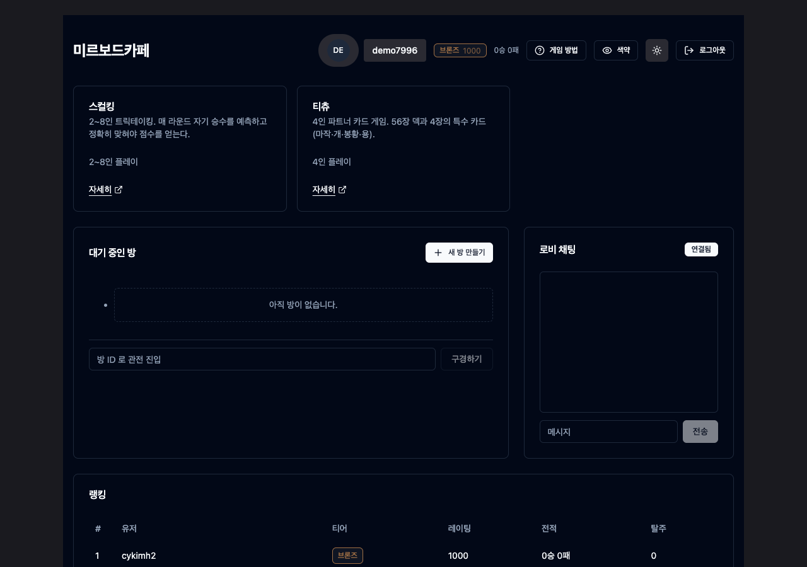
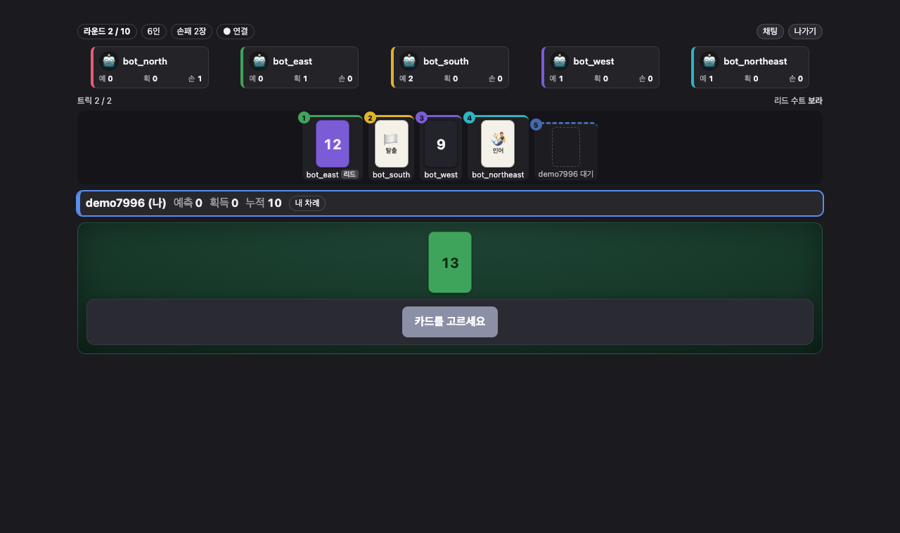
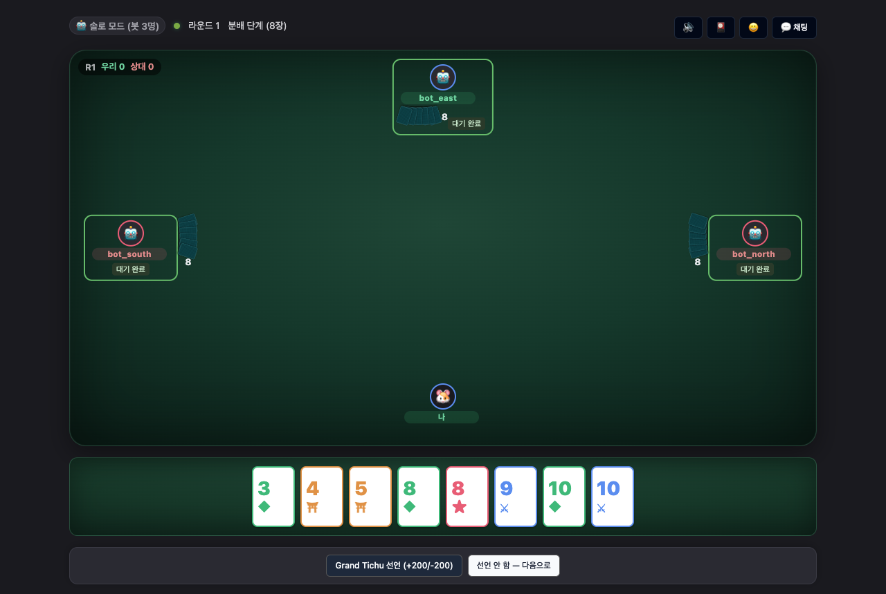

# Mirboard

**티츄·스컬킹·원카드·요트·오목·구름항로·씨앗포 일곱 개의 턴제 보드게임이 실제로 돌아가는 서버 권위(server-authoritative)
실시간 웹 플랫폼.** 셔플·족보 판별·점수 계산·차례 결정은 전부 서버가 하고, 클라이언트는
입력기와 뷰어입니다.

[](https://github.com/cykimh/mirboard/actions/workflows/ci.yml)
[](https://github.com/cykimh/mirboard/actions/workflows/deploy.yml)

Spring Boot 4 / Java 25 · PostgreSQL · Redis · React + TypeScript ·
서버 테스트 1971건 / 클라 1235건

**라이브**: https://mirboard.fly.dev — 로그인 화면 「게스트로 바로 체험하기」로 가입 없이 들어갈 수 있습니다. 지금 운영에는
일곱 게임(티츄·스컬킹·원카드·요트·오목·구름항로·씨앗포)이 모두 열려 있습니다(D-184 — 게임마다 설정 한 줄로 닫고 연다).
유휴 시 머신이 멈춰 첫 접속에 약 30초 걸립니다(콜드 스타트).

---


*메인 — 게임 카탈로그·방 목록/생성·관전·랭킹이 한 화면*


*스컬킹 — 6인 트릭테이킹. 예측은 전원 제출 후 동시 공개, 트릭은 재생순으로 늘어놓는다*


*티츄 — 4인 2:2 팀전. 특수 카드 4종(마작·개·봉황·용)과 그랜드 티츄 선언*

---

## 무엇이 되는가

| | 티츄 | 스컬킹 | 원카드 | 요트 | 오목 | 구름항로 | 씨앗포 |
| --- | --- | --- | --- | --- | --- | --- | --- |
| 인원 | 4인 고정, 2:2 팀전 | **2~8인 가변**, 개인전 | 2~6인 가변(처음 선택 4), 개인전 | **1~4인**(혼자 하기 가능), 개인전 | **2인 1:1 또는 4인 2:2 팀전**(대기실의 모드가 정원을 정한다) | 2~4인, 개인전 | 2~4인, 개인전 |
| 도구 | 56장 + 특수 카드 4종 | 70장(4색 × 1~14 + 특수 5종) | 54장(트럼프 52 + 조커 2) | 주사위 5개 · 12칸 점수표 | 15×15 판, 흑·백 돌 | 24칸 판(하늘섬 8 × 2) + 바람 편지 10장, 주사위 2개 | 부서지는 흙섬 전장(640×360칸), 화분 포대 · 콩알·호박탄 |
| 매치 | 목표 점수(기본 1000점) | 10라운드 고정 | 한 판(먼저 다 낸 사람 · 20장 파산) | 12라운드(칸을 다 채우면 끝) | 한 판(5목 · 판이 가득 차면 무승부) | 라운드 상한(4인 20) 뒤 총자산 순위, 1명만 남으면 끝 | 한 판(1명만 남으면 끝 · 10 × 인원 차례 뒤 구름 밀물) |
| 특징 | 족보 조합, 폭탄 인터럽트, 카드 패스 | 승수 예측 후 동시 공개, 비추이적 트릭 판정 | 공격 누적·반격, 1장 남으면 **"원카드!/잡기!" 실시간 경쟁**(무작위 위치 버튼, 서버 엔진 타이머), 턴 카운트다운 | 순차 진행, 남의 굴림·홀드·후보 점수를 실시간으로 구경, **차례 전체 제한**(서버 엔진 타이머) | 방장이 룰을 고른다(렌주 · 삼삼만 금지 · 자유), **금수 자리는 서버가 계산**, 2:2 는 같은 팀이 같은 색을 번갈아, 휴대폰 두 단계 확정 착수 | **독창 게임**(이름·판·카드 새로 만듦) — 땅 사기·건설·통행료·**인수**·축제·비행, 자동 청산·파산, 한 차례의 여러 결정을 포트 확장 없이 | **독창 게임** — 각도·힘·바람·지형 파괴, **서버가 한 발에 한 번 정수 물리로 계산**하고 클라는 대본을 재생만, 포트 확장 없이 |

- **로비/방** — 방 생성(인원 선택)·입장·관전·랭킹·채팅. 게임 시작은 정원 충족 + **전원 준비**
- **초대 링크** — 대기실에서 방 주소를 카톡 등으로 공유(방마다 다른 미리보기), 받은 친구는 가입 없이 게스트로 바로 그 방에 앉는다(자리가 다
  찼으면 관전, D-133). 방장이 카톡으로 나가 기다려도 대기실은 120초 동안 자리를 지킨다(D-134)
- **봇** — 대기실에서 방장이 [빈자리 봇으로 채우기]로 정원까지 봇을 앉힌다(D-174 — 사람과 섞어 할 수 있고, 판이 끝나면 봇과 함께 대기실로). 공개 게임 모두 공개 정보만 보는 결정적 휴리스틱이다(티츄 D-118 —
  랜덤 봇 상대 100전 100승, 스컬킹 D-230 — 공개 예측·지난 예측·빈 수트로 남의 패를 뽑아 끝까지 굴리는 몬테카를로, 2~8인 모두 기존 봇 대비 +126~+213점·8인 최약수 봇 대비 +248점(기존 봇은 비김), 원카드 D-128 — 무작위 봇 대비 4인 승률 0.92, 요트 — 1인
  평균 177점(무작위 봇 39점, 한 번 굴리고 바로 기록하는 봇 78점), 오목 D-179 — 듀플리케이트 200판 보통 대 무작위 1.000·어려움 대 보통 0.700(봇 3단계를 방 설정으로), 구름항로 D-212 — 무작위 대비 4인 0.78·"다 쓰는" 탐욕 대비 대등,
  씨앗포 D-222·D-224 — 같은 정수 엔진으로 후보 발사 1,100회를 시뮬레이션, 포대 3종을 섞어도 무작위 상대 60/60 승).
  원카드 봇은 경쟁 창마다 추첨한 반응 시간(기본 1.0~2.5초)에 누른다. 재현:
  `./gradlew :server:test --tests "com.mirboard.domain.game.*.bot.*"` (Docker 불필요)
- **재접속·탈주** — 끊김 유예 후 미복귀 시 게임별 규칙으로 처리
- **UI** — 라이트(기본)/다크 토글, 모바일 반응형

ELO·전적은 **게임별**로 쌓입니다(`user_game_stats`, [D-115](docs/decisions.md)) — 봇·게스트가 낀 매치는 승패만, ELO 는 제외.

전체 기능 표: [docs/implementation-status.md](docs/implementation-status.md)

---

## 기술적으로 흥미로운 지점

### 1. 두 번째 게임이 추상화의 결함을 정확히 한 곳 찾아냈다

`GameEngine` 포트(지금 184줄) 뒤에 티츄 6,048줄·스컬킹 3,815줄·원카드 2,647줄·요트 2,170줄·오목 2,838줄·구름항로 2,840줄·씨앗포 3,337줄이 꽂힙니다(재현 명령은 케이스 스터디
부록 (8)). 스컬킹을 붙일 때
**REST/WS 컨트롤러·스케줄러·브로드캐스터·로비는 한 줄도 바뀌지 않았고**, 인프라에
`skullking` 참조는 0건입니다.

바뀐 건 포트 계약 한 곳입니다 — `boolean desert(...)` 는 "매치를 강제 종료했는가"라는
2치라서, 개인전의 "남은 사람끼리 계속"을 표현할 수 없었습니다. 티츄만 있을 때 이 계약은
완벽해 보였습니다.

**추상이 어디서 샜는지 말할 수 있다는 것**이 "처음부터 완벽했다"보다 강한 증거라고 봅니다.
세 번째 게임 원카드("원카드!/잡기!" 실시간 경쟁)도 `GameEngine` 포트 확장 1건 — 시간이 지나면 일어나는 전이(`timer`/`onTimer`)
— 으로 붙었고(카탈로그 정의의 방 만들기 처음 선택 기본값 2개 `defaultPlayers`/`defaultTurnSeconds` 는 별도 — D-130, 기본 구현이
기존 동작) 인프라의 `onecard` 참조는 0건입니다. 대신 처음으로 시간에 기대는 게임이 인프라의 시간 가정 셋을 드러냈습니다.
네 번째 게임 요트는 계획서가 예상한 깨짐(비공개 뷰 없음·12칸 종료·조합 폭발)이 이미 포트에 들어 있었고, 실제로 깬 것은 표에 없던
"액션 하나 = 차례 하나" 가정이었습니다 — `GameContext.turnSeconds` 하나로 차례 전체 마감을 엔진 타이머에 걸었고 인프라 코드는 0줄입니다.
다섯 번째 게임 오목은 대기실의 모드(1:1 / 2:2)가 정원(2 또는 4)을 정해 "정원은 카탈로그 상수"라는 가정을 깼습니다 — 게임 중립 확장 3건
(방 옵션 맵·`capacityFor`/`playersToStart`·`GameContext.options`, D-176)으로 붙었고 인프라의 `omok` 참조는 0건입니다.

구름항로(주사위·부동산)는 **포트 확장 0건**으로 붙었습니다 — 한 차례 안의 여러 결정(굴리기·사기·짓기·인수)을
상태의 "기다리는 결정" 하나로 풀어 액션 하나 = 결정 하나로 맞췄고, 인프라의 `cloudroute` 참조는 0건입니다.
씨앗포(턴제 포격)도 **포트 확장 0건**입니다 — 서버가 발사 순간 정수 물리(Q16·삼각 정수표)로 끝까지 계산해 대본을 보내고, 연출 대기는
원카드가 넣은 엔진 타이머로, 이동은 발사에 실었습니다. 한 발 0.064ms, 인프라의 `artillery` 참조는 0건입니다.

→ [케이스 스터디: 두 번째 게임을 붙이기까지](docs/case-study-multi-game.md)(세 번째 게임은 §8, 네 번째는 §9, 다섯 번째 오목은 §10, 여섯 번째 구름항로는 §11, 일곱 번째 씨앗포는 §12) ·
[포트 계약](docs/game-port.md)

### 2. 비추이적 트릭 판정을 6단 사다리로

스컬킹의 해적 > 인어 > 스컬킹 > 해적 은 **3자 순환**이라 `Comparator` 로 표현할 수 없고,
거기에 "셋이 다 나오면 인어 승"이라는 예외까지 얹힙니다.

```java
// 실제 코드에서 EffectiveKind. 접두만 생략
private record Rung(Predicate<Context> applies, ToIntFunction<Context> pick) {}

private static final List<Rung> LADDER = List.of(
        // 1. 스컬킹+인어 → 인어 (3자 예외)
        new Rung(c -> c.has(SKULL_KING) && c.has(MERMAID), c -> firstOfKind(c, MERMAID)),
        // 2~4. 스컬킹 → 해적 → 인어
        new Rung(c -> c.has(SKULL_KING), c -> firstOfKind(c, SKULL_KING)),
        new Rung(c -> c.has(PIRATE),     c -> firstOfKind(c, PIRATE)),
        new Rung(c -> c.has(MERMAID),    c -> firstOfKind(c, MERMAID)),
        // 5. 색상 카드 (검정 우선, 없으면 리드 수트)
        new Rung(c -> c.has(SUIT),       TrickResolver::highestSuitCard),
        // 6. 전부 탈출 → 먼저 낸 사람
        new Rung(c -> true,              c -> firstOfKind(c, ESCAPE)));
```

모든 단의 selector 가 `firstOfKind` 라서 **동점 처리("그 종류를 먼저 낸 사람")가 분기 없이
공짜로 성립**합니다. 검증은 스컬킹/해적/인어 존재 여부 8조합 전수 대조입니다.

→ [코드](server/src/main/java/com/mirboard/domain/game/skullking/trick/TrickResolver.java) ·
[테스트](server/src/test/java/com/mirboard/domain/game/skullking/trick/TrickResolverTest.java) ·
[룰 명세](docs/rules-skullking.md)

### 3. 상태 은닉을 런타임 필터가 아니라 타입으로

스컬킹의 "예측은 전원 제출 후 동시 공개" 룰은 **값을 실을 자리가 없어서** 지켜집니다.

```java
/** 예측을 냈다는 사실만 공개 — 값은 담지 않는다 (§5 동시 공개). */
record BidSubmitted(int seat) implements SkullKingEvent {}
record BidsRevealed(Map<Integer, Integer> bids) implements SkullKingEvent {}
```

손패도 같은 원리입니다 — 공개 `TableView` 와 본인용 `PrivateHand` 를 **다른 타입**으로
두고, 라우팅은 `GameEvent.privateSeat()` 단일 지점에서만 갈립니다. 좌석이 방 범위 밖이면
토픽으로 폴백하지 않고 **버립니다**. 새는 경로 자체가 없는 구조입니다.

→ [포트](server/src/main/java/com/mirboard/domain/game/core/GameEvent.java) ·
[STOMP 계약](docs/stomp-protocol.md)

### 4. 수평 확장을 "증명"으로 다뤘다

> 단일 인스턴스에서 안 깨졌다는 건 증명이 아니다.

같은 Redis/Postgres 를 문 **독립 Spring 컨텍스트 2개**를 띄워 교차 발화, A 종료 후 B 인계,
중복 실행 0건을 통합 테스트로 검증했습니다. in-memory 였던 3곳(세션 레지스트리·턴 타임아웃·
탈주 유예)을 Redis 로 옮기면서 초기 전제([D-03](docs/decisions.md))를 D-96 에서 명시적으로
번복했습니다. 리더 선출 대신 원자 pop + generation 이중 방어를 택한 논거는 코드 주석에
남겼습니다.

이 과정에서 폴링 지연 때문에 타임아웃 IT 가 **실제로 깨져** 주기를 1s → 250ms 로 내렸습니다.

→ [Redis 키 설계](docs/redis-keys.md)

---

## 아키텍처 4원칙

각 원칙 뒤에 **무엇이 그것을 강제하는가**를 함께 적습니다.

- **Modular Monolith** — `domain.lobby` → `domain.game.tichu` 직접 의존 금지.
  강제: 게임 디스패치가 `GameRegistry` 를 반드시 거친다.
- **Server-Authoritative** — 셔플·족보·점수·차례가 전부 서버.
  강제: 클라가 보낸 `seq` 는 무시하고 `room:{id}:seq` INCR 만 신뢰.
- **State Hiding** — 손패는 `/user/queue` 로만.
  강제: 타입 분리 + 단일 라우팅 지점(폴백 경로 없음).
- **개인정보 최소화** — `users` 에 email·phone·real_name 등은 **스키마 레벨에서 추가 금지**.
  증거: 칩 잔액을 `users` 에 넣었다가(V6) 원칙 위배로 **DROP 하고**(V7) Redis 방 단위로
  옮겼습니다. 원칙이 이미 배포된 스키마를 되돌리게 만든 사례입니다.

```
로그인 → 메인(/games) → 대기실(전원 준비) → 게임판
          방 목록·생성·관전·랭킹·채팅
```

상세: [docs/architecture.md](docs/architecture.md)

---

## 기술 스택

| 영역 | 선택 |
| --- | --- |
| Backend | Spring Boot 4.0.1 / Java 25 (Virtual Threads), Gradle 9.4.1 |
| Data | PostgreSQL 16 (Flyway V1~V16), Redis 7 + **Lua 원자 스크립트 16개** |
| Realtime | WebSocket + STOMP (SockJS 폴백) |
| Frontend | Vite + React 18 + TypeScript, Zustand, Tailwind + shadcn/ui |
| Test | JUnit 5 + Mockito + Testcontainers / Vitest + RTL |

`HandType`·`GameAction`·`GameEvent` 는 **sealed interface** 로 두어 `switch` 패턴 매칭이
누락 케이스를 컴파일 타임에 잡게 했고, 상태 객체는 record + `with*` 불변 전이입니다.

---

## 30초 실행

```bash
./scripts/dev.sh all
```

Postgres·Redis 기동 → 마이그레이션 → 서버(:8080) → 클라(:5173) 까지 한 번에 올라갑니다.
개별 실행은 `./scripts/dev.sh up | server | client`.

환경 설치·테스트 실행·검증 스크립트는 → **[CONTRIBUTING.md](CONTRIBUTING.md)**

---

## 문서

**훑어보기** — [아키텍처](docs/architecture.md) ·
[포트 설계](docs/game-port.md) ·
[케이스 스터디](docs/case-study-multi-game.md) ·
[의사결정 이력](docs/decisions.md)

**깊이 보기** — [REST API](docs/api.md) ·
[STOMP 프로토콜](docs/stomp-protocol.md) ·
[Redis 키](docs/redis-keys.md) ·
[티츄 룰](docs/rules-tichu.md) ·
[스컬킹 룰](docs/rules-skullking.md) ·
[원카드 룰](docs/rules-onecard.md) ·
[요트 룰](docs/rules-yacht.md) ·
[구름항로 룰](docs/rules-cloudroute.md) ·
[구현 현황](docs/implementation-status.md)

**돌려보기** — [기여 가이드](CONTRIBUTING.md) ·
[배포](docs/deploy.md) ·
[수동 검증 시나리오](docs/qa-scenarios.md) ·
[백업 런북](docs/runbooks/) ·
[부하 테스트](scripts/k6/)

의사결정 이력은 100여 건이고, **번복을 지우지 않고 마커로 남깁니다** — 예를 들어
"단일 인스턴스 전제"(D-03)는 D-96 에서, "칩을 계정에 둔다"(D-81)는 D-82 에서 뒤집혔습니다.
진행 단계는 [로드맵](docs/plans/mvp-roadmap.md).
